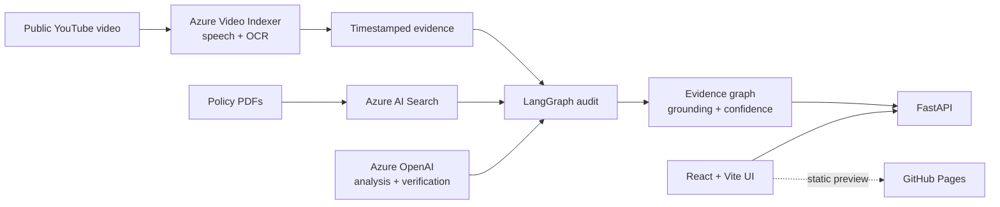

# NEXUS COMPLY

<p align="center">
  <strong>Evidence-grounded video compliance auditing</strong><br />
  Analyze video speech and on-screen text, then trace findings back to evidence and policy.
</p>

<p align="center">
  <a href="https://mahantheshvinu.github.io/UNI-MAIN-PROJECT-V2/">
    
  </a>
  
  
</p>

> **Live preview note:** GitHub Pages currently hosts the frontend only. Audits require the backend and Azure services, which are not deployed online yet. Run the full app locally using the instructions below.

## What it does

NEXUS COMPLY audits public YouTube videos for brand and policy compliance. It extracts speech and on-screen text, retrieves policy documents, and produces findings with evidence, verification, confidence, and provenance details.



### Audit trace

```text
Video -> Speech/OCR evidence -> Temporal clusters -> Candidate findings
      -> Support and counter-evidence -> Grounding -> Policy provenance
      -> Confidence components -> Audit dossier
```

The API response includes `evidence_items`, `temporal_clusters`, `evidence_graph`, `verified_compliance_results`, `confidence_results`, `policy_provenance`, and `audit_dossier`. See [TECAR methodology](docs/TECAR.md) for the evidence-chain design.

## Run locally on Windows

### 1. Install prerequisites

- Python 3.14 or newer
- [uv](https://docs.astral.sh/uv/)
- Node.js 20 or newer and npm
- Azure CLI
- Access to Azure OpenAI, Azure AI Search, and Azure Video Indexer resources

### 2. Create Azure resources and credentials

In the [Azure portal](https://portal.azure.com/):

1. **Azure OpenAI / AI Foundry:** create or select a resource, deploy one chat model and one embedding model, then copy the endpoint and API key. Record the deployment names exactly as shown.
2. **Azure AI Search:** create or select a search service. Copy its endpoint and an admin key from **Settings → Keys**. Choose an index name; the indexing script creates/populates it.
3. **Azure Video Indexer:** create or select an account. Record its resource name, account ID, location, resource group, and subscription ID.
4. **Grant your identity access:** sign in with `az login`. Grant the signed-in identity **Video Indexer Account Contributor** on the Video Indexer account and **Cognitive Services OpenAI User** on the Azure OpenAI resource. The document indexing script uses your Azure CLI identity for embeddings.

Create a `.env` file in the repository root and fill in your own values:

```dotenv
AZURE_OPENAI_ENDPOINT=https://<your-openai-resource>.openai.azure.com/
AZURE_OPENAI_API_KEY=<your-openai-key>
AZURE_OPENAI_API_VERSION=<supported-api-version>
AZURE_OPENAI_CHAT_DEPLOYMENT=<chat-deployment-name>
AZURE_OPENAI_EMBEDDING_ENDPOINT=https://<your-embedding-resource>.openai.azure.com/
AZURE_OPENAI_EMBEDDING_DEPLOYMENT=<embedding-deployment-name>

AZURE_SEARCH_ENDPOINT=https://<your-search-service>.search.windows.net
AZURE_SEARCH_API_KEY=<your-search-admin-key>
AZURE_SEARCH_INDEX_NAME=uni-index

AZURE_VI_NAME=<your-video-indexer-resource-name>
AZURE_VI_LOCATION=<your-video-indexer-location>
AZURE_VI_ACCOUNT_ID=<your-video-indexer-account-id>
AZURE_VI_RESOURCE_GROUP=<your-resource-group>
AZURE_SUBSCRIPTION_ID=<your-subscription-id>
```

Use the same endpoint for both OpenAI endpoint entries if both deployments are in the same resource. Keep the `.env` file private; `.gitignore` excludes it. Never paste keys into source code, issues, or commits. Azure service usage may incur charges.

### 3. Sign in, index policies, and start

```powershell
az login
az account set --subscription "<your-subscription-id>"
uv run python backend/scripts/index_documents.py
.\START_NEXUS_COMPLY.bat
```

The indexing command loads PDFs from `backend/data`. The startup script syncs dependencies, starts the API and frontend, and opens the UI.

| Service | Address |
| --- | --- |
| Web UI | <http://localhost:5173> |
| API health | <http://127.0.0.1:8000/health> |
| API documentation | <http://127.0.0.1:8000/docs> |

Select a sample or enter a public YouTube URL to start an audit. Processing may take several minutes.

## Tech stack

`React` · `Vite` · `FastAPI` · `LangGraph` · `Azure OpenAI` · `Azure AI Search` · `Azure Video Indexer`